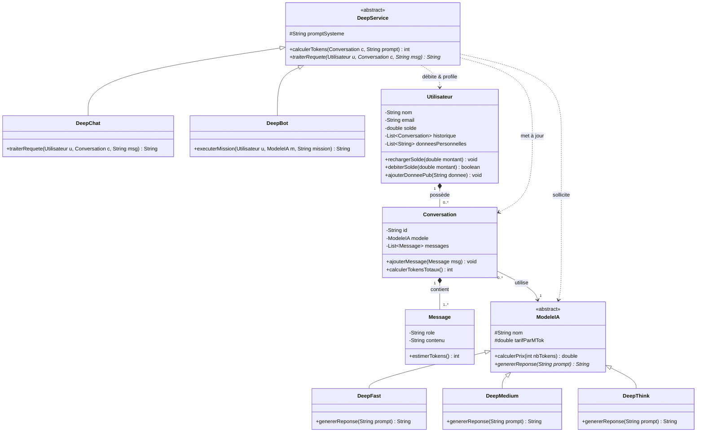

# DeepAI - Backend Plateforme IA (Java)

Projet de Programmation Orientée Objet (POO) en Java pour la plateforme **DeepAI**.

## Auteurs (Binôme)
- Étudiant : Abdenour GH
- Université de Corse - gueniot_f@univ-corse.fr

---

## 1. Description du Projet
DeepAI est une plateforme de backend pour modèles d'intelligence artificielle proposant :
- **Trois modèles d'IA** adaptés selon les cas d'usage :
  - `DeepFast` : Modèle rapide et économique (0,10 $ / MTok).
  - `DeepMedium` : Modèle polyvalent (0,50 $ / MTok).
  - `DeepThink` : Modèle à raisonnement avancé (1,00 $ / MTok).
- **Deux canaux d'accès** :
  - `DeepChat` : Interface de discussion interactive.
  - `DeepBot` : API pour agents autonomes (CLI / VSCode).
- **Monétisation au token** : Facturation transparente par token consommé, incluant le prompt système et l'intégralité de l'historique de la conversation.
- **Gestion utilisateurs** : Comptes avec solde provisionnable et profilage pour publicités ciblées.

---

## 2. Diagramme de Classes UML

---

## 3. Mention relative à l'usage de l'IA générative
Conformément aux consignes du cours, l'assistance d'outils d'IA générative a été utilisée avec parcimonie pour la structuration initiale de l'architecture UML et le brainstorming des cas de test. L'ensemble des règles de gestion orientée objet et du code Java a été implémenté et validé par le binôme.
