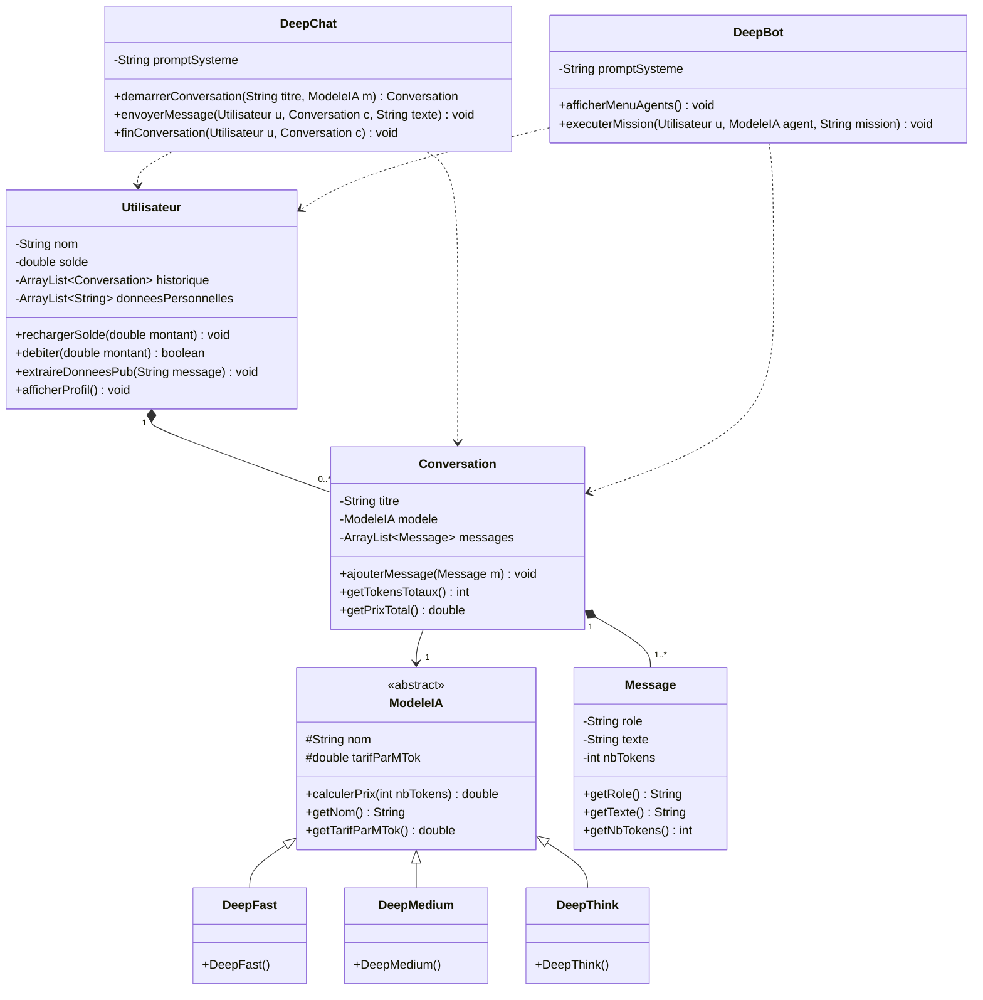

# TP Java : DeepAI

Projet de Programmation Orientée Objet (Java) - Université de Corse

## Auteur
- **Étudiant :** Abdenour GAHFIF  Ghoulam TOUAREF
- **Enseignant :** gueniot_f@univ-corse.fr
- équipe: 04

---

## 1. Description du projet
Le projet simule le backend de la start-up **DeepAI** :
- **3 modèles d'IA** avec leurs tarifs respectifs :
  - `DeepFast` : 0,10 $ / MTok
  - `DeepMedium` : 0,50 $ / MTok
  - `DeepThink` : 1,00 $ / MTok
- **DeepChat** : interface de discussion où l'utilisateur échange avec un modèle.
- **DeepBot** : interface pour exécuter des tâches sous forme d'agents autonomes.
- **Monétisation au token** : calcul des tokens consommés (incluant le prompt système et l'historique) et facturation sur le solde de l'utilisateur.
- **Gestion utilisateurs** : création de compte, gestion du solde et détection de centres d'intérêt pour la publicité ciblée.

---

## 2. Diagramme de classes UML

---

## 3. Utilisation de l'IA générative
Conformément aux consignes du TP :
La conception orientée objet ainsi que la logique des classes ont été réfléchies et définies par NOUS.

L'IA a été utilisée comme un outil d'accompagnement pour mieux comprendre le sujet, les différentes méthodes et fonctions, ainsi que leur rôle dans le programme.

Elle a également été sollicitée pour faciliter la gestion des méthodes répétitives, notamment les getters, ainsi que pour comprendre et structurer la fonction main.

Enfin, l'IA a été utilisée ponctuellement pour améliorer la mise en forme du fichier README et la syntaxe du diagramme Mermaid.

L'ensemble du code a été étudié et compris par NOUS, qui reste responsable des choix de conception et de l'implémentation.
